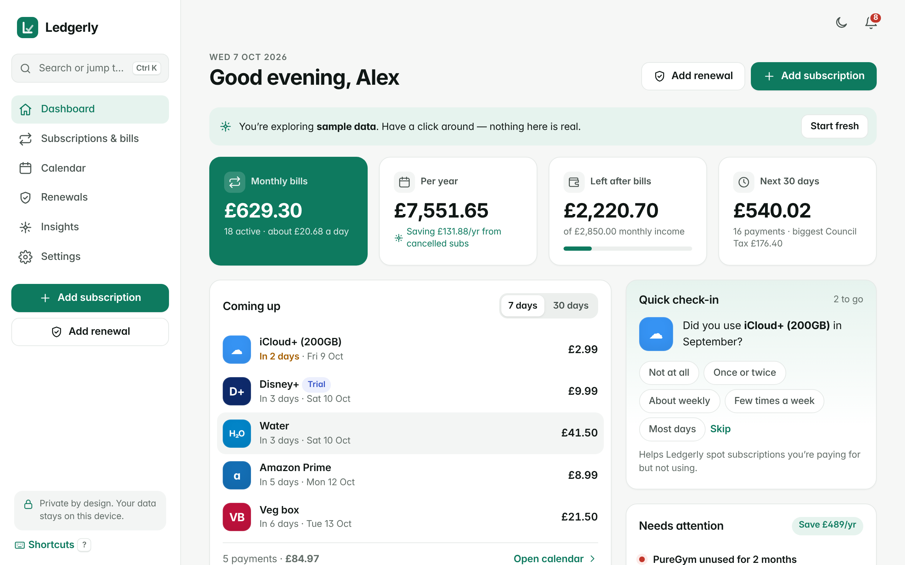
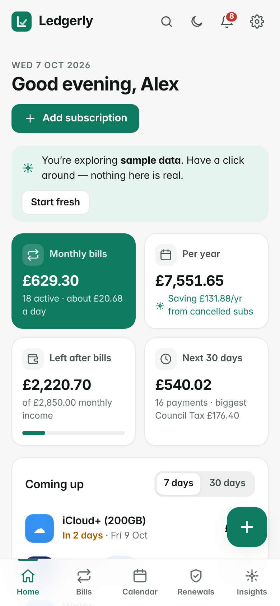
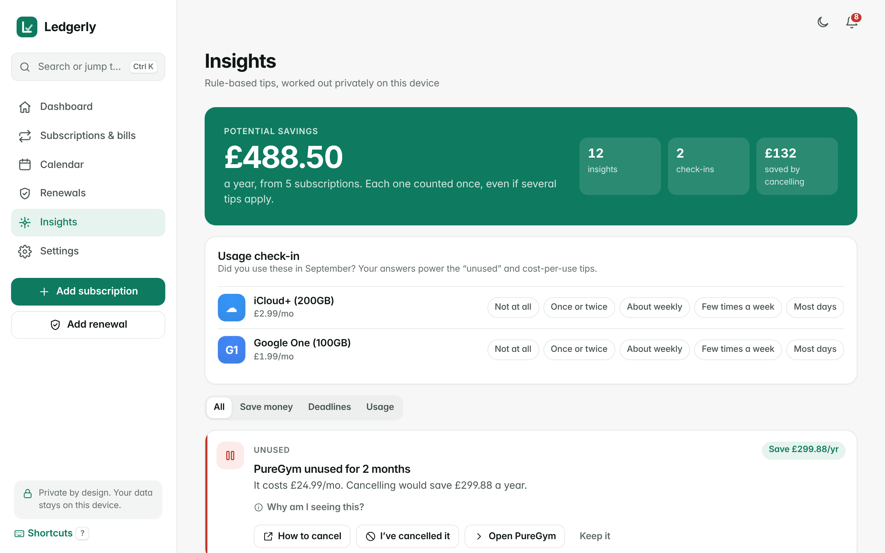
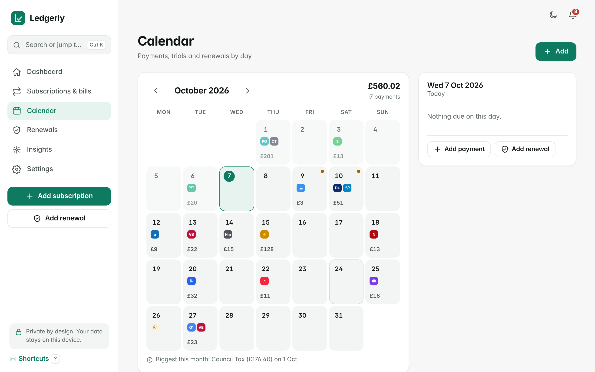
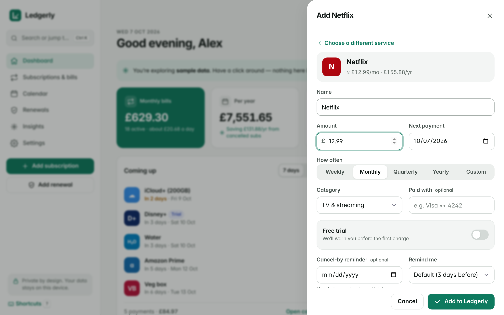
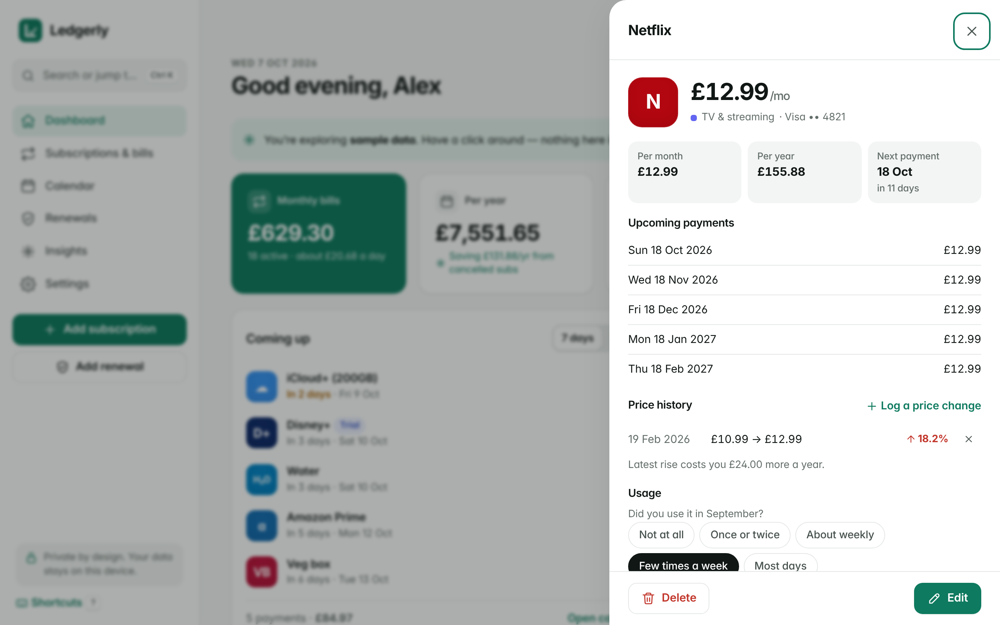
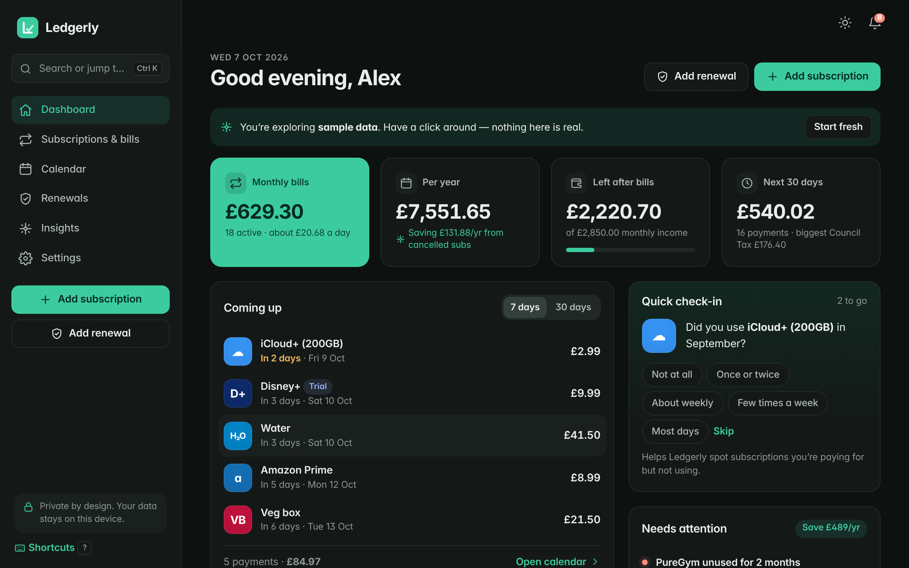

# Ledgerly

**Never be surprised by a bill again.** Ledgerly is a private life-admin app for your subscriptions, bills, free trials and renewals (passport, MOT, car insurance, TV licence and more). It shows what you really pay each month, warns you before money leaves your account and finds savings. It does all of this **without an account, a bank login or a server.**



| Mobile | Insights | Calendar |
|---|---|---|
|  |  |  |

| Add a subscription | Item detail | Dark mode |
|---|---|---|
|  |  |  |

---

## The problem it solves

The average UK household loses money on things it has forgotten about: a free trial that quietly turned into £9.99 a month, two music services, a gym that hasn't been used since January, a 15% broadband price rise nobody noticed, or a passport that expires two weeks before a holiday. Banking apps show transactions *after* they happen. Ledgerly shows what's **coming** and tells you **what to do about it**.

## Features

**See everything**
- **Dashboard:** your true monthly and yearly cost (weekly, fortnightly, quarterly and yearly bills all converted correctly), money left after bills, what's due in the next 7 or 30 days, a 12-month cash-flow projection and a category breakdown.
- **Calendar:** a month view of every payment, trial end and renewal. Click a day to see what's due or to add something on that date.
- **Subscriptions & bills:** search, filter by status or category, sort, and export to CSV.

**Get warned in time**
- **Free trials:** set the trial end date and a "cancel by" date, and Ledgerly warns you before you're charged.
- **Renewals:** 19 document types (passport, driving licence photocard, MOT, car tax, home insurance, TV licence, boiler service and more). Each has a sensible reminder window, a link to the official GOV.UK renewal page and one-tap "Renewed", which suggests the next expiry date.
- **Reminders centre** in the app, plus optional **browser notifications**.
- **Calendar export (.ics):** add every bill and renewal to Google Calendar, Outlook or Apple Calendar, with alerts that fire even when Ledgerly is closed.

**Save money**
- **Insights**, each with a plain-English "Why am I seeing this?":
  - overlapping services (for example two music or cloud-storage plans)
  - recent price rises, with the % change and the yearly cost
  - trials ending soon and cancel-by deadlines
  - unused subscriptions and high cost per use, from quick monthly usage check-ins
  - cheaper annual plans
  - bills taking a large share of your income
- **Potential savings total.** Each subscription is counted only once.
- **Cancellation helper:** a direct link to the real cancellation page for each of the 86 built-in services, plus a tip.
- **Price history** for every subscription.

**Feels like a real app**
- 60-second onboarding: tap the services you pay for from a library of 86 UK services with typical prices, or explore with sample data first.
- Command palette (**Ctrl/Cmd + K**) for jumping anywhere, opening any subscription or adding from the library.
- Keyboard shortcuts (press **?**), dark mode, reduced-motion support, and full keyboard and screen-reader support.
- Undo for deletes, mobile layout with a bottom tab bar, and a desktop layout with a sidebar.
- Installable as an app (PWA) that works offline, when run with `start.bat`.
- 17 currencies (GBP by default).

## How to run it (Windows)

**Option 1: just open it.** Double-click `index.html`. Everything works in Chrome or Edge with no install.

**Option 2: as an installable, offline app (recommended).** Double-click **`start.bat`**. It uses Node.js (already installed at `C:\Program Files\nodejs`) to serve the folder at <http://localhost:8080> and opens your browser. Keep the black window open while you use it. In Chrome or Edge, click the install icon in the address bar to get Ledgerly as a desktop app. If Node.js isn't found, `start.bat` opens `index.html` instead.

From a terminal you can also run:

```bash
npm start        # same as start.bat (port 8080; uses the next free port if busy)
npm test         # 46 unit tests for the recurrence engine, totals, insights and .ics export
```

> **Note:** the browser stores data separately for `index.html` (option 1) and `localhost:8080` (option 2). Pick one way and stick with it, or move your data with **Settings → Export backup / Import backup**.

## Privacy

- **Everything stays on your device.** Data is saved in your browser's local storage. There is no server, no account, no analytics, no cookies and no tracking. The app makes no network requests at all.
- **No bank connection.** You add what you pay for. Nothing reads your transactions.
- **You own your data:** export it as JSON (a full backup) or CSV (for Excel) whenever you like, import it on another device, or delete everything in one click.
- Clearing your browser data will also erase Ledgerly's data, so export a backup now and then.

## Project structure

```
ledgerly/
├── index.html              App shell
├── start.bat               Windows launcher (Node static server, or open the file)
├── serve.js                Zero-dependency local web server
├── sw.js                   Service worker (offline support)
├── package.json            npm start / npm test
├── assets/                 Manifest + app icons (SVG / PNG)
├── css/                    base.css · layout.css · components.css · views.css
├── js/
│   ├── dates.js            Recurrence engine (UTC day maths, month-end safe)
│   ├── finance.js          Totals, projections, upcoming payments
│   ├── insights.js         Rule-based savings & deadline insights
│   ├── ics.js              RFC 5545 calendar export
│   ├── library.js          86 services, 19 document types, 17 currencies
│   ├── store.js            localStorage persistence, validation, undo
│   ├── sample.js           Realistic sample household
│   ├── util.js charts.js notify.js ui.js app.js
│   └── views/              dashboard, subscriptions, calendar, documents,
│                           insights, settings, onboarding, sheets, common
├── tests/                  node --test unit tests
└── docs/screenshots/
```

The app is plain HTML, CSS and JavaScript with **zero dependencies** and no build step.

## Under the hood

- **Recurrence that doesn't drift.** Every payment date is calculated from the original start date, so a bill on the 31st lands on 28/29 Feb, 30 Apr and back on 31 May. It never "sticks" on the 28th. Dates are handled as calendar days, so clock changes can't shift them.
- **Honest monthly maths.** Weekly and fortnightly costs use the average year length (365.2425 days): £10 a week is £521.78 a year, not £480.
- **Calendar export** uses RRULEs that match the app's own dates exactly, including month-end and 29 February rules. Lines are folded at 75 octets with CRLF endings, and VALARM reminders are included. A test checks the exported rules against the engine.

## Limitations

- Browser notifications only fire while Ledgerly is open in a tab. Use the **.ics calendar export** for reminders when it's closed.
- Changing currency changes the symbol and formatting; it doesn't convert existing amounts.
- Library prices are typical UK prices at the time of writing. Check and edit them to match your plan.
- Data lives in one browser on one device. Use Export/Import to move it; there's no cloud sync, by design.
- Offline mode and installing as an app need `start.bat` (or any web server). Opening `index.html` directly works fully but can't be installed.
- Date pickers display in your browser's language format.

## License

MIT
